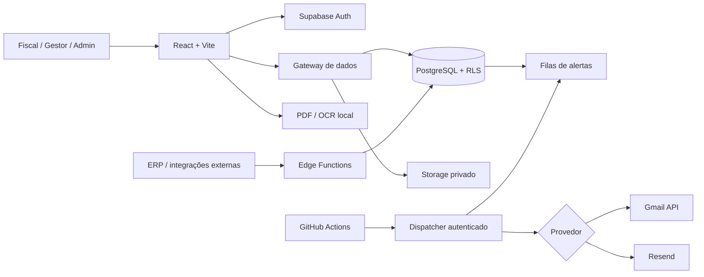

<div align="center">

# 📑 LICITS
### Plataforma de gestão e fiscalização de contratos

**Contratos, saldos, consumo, documentos, ocorrências, vencimentos e auditoria em um só lugar.**

[](https://github.com/WalterMatheusgg/Licits/actions/workflows/ci.yml)
[](https://github.com/WalterMatheusgg/Licits/actions/workflows/edge-functions-ci.yml)
[](https://github.com/WalterMatheusgg/Licits/actions/workflows/supabase-db-ci.yml)


**Status: desenvolvimento e homologação · Ainda não aprovado para produção**

[Funcionalidades](#-funcionalidades) · [Arquitetura](#-arquitetura) · [Instalação](#-executar-localmente) · [E-mails](#-notificações-por-e-mail) · [Segurança](#-segurança) · [Documentação](#-documentação)

</div>

---

## 🎯 Sobre o projeto

O **Licits** centraliza o acompanhamento de contratos para fiscais e gestores: valores, itens contratados, utilização, prazos, evidências, responsabilidades e rastreabilidade das operações.

A plataforma foi concebida para ajudar a responder a quatro perguntas importantes:

- **Quanto já foi utilizado?** Acompanhe consumo por item e impacto no valor contratual.
- **O que está prestes a vencer?** Identifique contratos e prazos que exigem providências.
- **O que requer fiscalização?** Consulte tarefas, ocorrências, documentos e registros.
- **Quem fez o quê?** Mantenha controles por organização, permissões e trilhas de auditoria.

> Utilização de itens contratados e saldo financeiro não equivalem ao estoque físico de almoxarifado. O Licits acompanha a execução contratual, não substitui decisões administrativas ou procedimentos legais.

## ✨ Funcionalidades

| Módulo | Recursos presentes no projeto |
| --- | --- |
| **Dashboard** | Indicadores, prazos, saldos e acompanhamento de contratos |
| **Contratos e fornecedores** | Cadastro, consulta, valores, itens e responsáveis |
| **Compras e consumo** | Prévia da utilização; controles transacionais contra excesso de quantidade ou valor |
| **Fiscalização** | Carteira do fiscal, registros, tarefas, ocorrências e evidências |
| **Atas de registro de preços** | Atas, grupos, itens e vínculos contratuais |
| **Documentos** | Storage privado, leitura de PDF, OCR local e revisão de informações |
| **Organizações e equipe** | Supabase Auth, convites, perfis, papéis e isolamento de dados |
| **Notificações** | Alertas de orçamento e vencimento com fila de processamento |
| **Integrações** | API de contratos, credenciais por integração, controles de escopo e OpenAPI |
| **Auditoria** | Registro de operações relevantes e verificações de segurança |

O projeto também possui recursos locais de consulta estruturada. Eles **não representam um modelo generativo próprio treinado localmente**. Componentes opcionais de IA externa exigem configuração e validação independentes.

### Alertas contratuais

| Evento | Tratamento |
| --- | --- |
| Consumo de **80%, 90% e 100%** do orçamento | Fila de alertas orçamentários |
| Vencimento em **30, 7, 1 e 0 dias** | Fila de alertas de vigência |
| Destinatários | Fiscal atribuído e administradores ativos da organização, conforme política de elegibilidade |
| Agendamento | Workflow GitHub Actions a cada **30 minutos** |
| Falhas | Registro de status e novas tentativas conforme as regras de fila |

O aceite da API de e-mails **não comprova a entrega final**. Verifique também o provedor e a caixa de destino.

[Contrato fictício de demonstração](docs/CONTRATO-DEMONSTRACAO.md) · [Guia dos alertas](docs/ALERTAS-FISCAL.md)

## 🧱 Arquitetura



**Stack:** React 18, Vite 6, JavaScript/TypeScript, Tailwind CSS, Supabase Auth, PostgreSQL, RLS, Supabase Storage, Edge Functions (Deno), GitHub Actions e integração OAuth com Gmail.

A autorização de operações acontece no banco e nas funções de servidor. **Esconder botões na interface não substitui autorização no backend.**

## 🚀 Executar localmente

**Requisitos:** Node.js **22**, npm, Git e um projeto Supabase de desenvolvimento/homologação autorizado.

```bash
git clone https://github.com/WalterMatheusgg/Licits.git
cd Licits
npm ci
cp .env.example .env.local
```

Preencha `.env.local` com **somente os valores públicos** do Supabase:

```dotenv
VITE_SUPABASE_URL=https://SEU-PROJETO.supabase.co
VITE_SUPABASE_PUBLISHABLE_KEY=SUA_CHAVE_PUBLICA
VITE_ENVIRONMENT=development
```

Inicie o frontend:

```bash
npm run dev
```

Abra a URL exibida pelo Vite, geralmente `http://localhost:5173`. No Codespaces, encaminhe a porta **5173** em **Ports**.

### Migrations

Confira o ambiente de destino e tenha um backup recuperável antes de executar qualquer migration:

```bash
npx supabase login
npx supabase link --project-ref SEU_PROJECT_REF
npx supabase migration list
npx supabase db push --dry-run
# Após revisar as mudanças e o destino:
# npx supabase db push
```

[Configuração de autenticação](docs/AUTHENTICATION.md) · [Recuperação de acesso](docs/RECUPERAR-ACESSO.md)

## ✉️ Notificações por e-mail

O backend suporta dois provedores, selecionados com o secret `EMAIL_PROVIDER`:

| Provedor | Requisitos | Observações |
| --- | --- | --- |
| **Gmail API** | Conta remetente Google, OAuth Client ID/Secret, Refresh Token e escopo `gmail.send` | Envia a endereços externos sem comprar domínio; sujeito aos limites e políticas do Gmail |
| **Resend** | Chave de API e remetente de domínio verificado | Serviço transacional alternativo |

O módulo compartilhado `supabase/functions/_shared/email-provider.ts` é utilizado pelas funções `send-email` e `dispatch-budget-alerts`. Segredos ficam **somente** no servidor.

Configuração interativa do Gmail, sem imprimir credenciais:

```bash
bash scripts/configurar-gmail.sh
npx supabase functions deploy send-email --use-api
npx supabase functions deploy dispatch-budget-alerts --no-verify-jwt --use-api
```

A flag `--use-api` é útil caso o empacotamento local falhe por DNS no Codespaces.

O agendamento de alertas exige `LICITS_DISPATCH_URL` e `LICITS_ALERT_DISPATCH_SECRET` no GitHub, com o mesmo valor de token em `ALERT_DISPATCH_SECRET` no Supabase. Script de configuração:

```bash
bash scripts/configurar-alertas.sh
```

**Situação atual da integração:** o código Gmail está publicado, e as duas funções foram implantadas no projeto Supabase de homologação. **A confirmação de um e-mail real recebido ainda está pendente.** Uma execução com `processed: 0` comprova apenas a chamada ao dispatcher.

> Em aplicativos OAuth externos no estado *Testing*, Refresh Tokens do Google podem expirar em aproximadamente **sete dias**. Para operar continuamente, regularize o fluxo de autorização e monitore falhas; Gmail não oferece envio ilimitado. Convites enviados por Supabase Auth utilizam uma configuração de e-mail independente.

[Configuração Gmail/Resend e critérios de aceite](docs/ALERTAS-FISCAL.md)

## 🧪 Testes e CI

```bash
npm ci
npm run lint
npm run typecheck
npm run build
node --test tests/*.test.js
deno test supabase/functions/_shared/*.test.ts
```

| Pipeline | Cobertura |
| --- | --- |
| **Frontend** | Lint, typecheck, build e testes de arquitetura |
| **Edge Functions** | Testes Deno de segurança, destinatários, adaptadores e validação de tipos |
| **Supabase SQL** | Migrations, regressões e cenários transacionais em CI |

**Homologação:** os pipelines de frontend e Edge Functions foram aprovados nas execuções recentes. O pipeline SQL apresentou falha e deve ser diagnosticado antes da aprovação para produção. Testes locais não substituem validação ponta a ponta, RLS remoto, e-mails reais e restauração de backups.

## 🔐 Segurança

- **Supabase Auth**, perfis ativos e vínculos de organização.
- **RLS** e escopo de acesso por organização no PostgreSQL.
- Controle de papel para fiscalização, administração e integrações.
- Validação transacional de movimentações e teto contratual.
- Auditoria, verificação de destinatários e tratamento seguro de erros.
- Tokens de provedores e chaves administrativas **nunca** versionados ou expostos em `VITE_`.

**Pronto para produção? Ainda não.** É necessário solucionar o CI SQL, validar fluxos e isolamento no ambiente remoto, comprovar entrega de e-mail, manter OAuth estável, configurar monitoramento e testar restauração integral de banco e arquivos.

[Políticas de segurança](docs/SECURITY.md) · [Homologação remota](docs/HOMOLOGACAO-REMOTA.md) · [Backup e restauração](docs/PRODUCAO-RECUPERACAO.md)

## 🔄 Sincronizar Codespaces e GitHub

Há um script para manter `main` sincronizada **nos dois sentidos**, sem descartar arquivos locais e sem executar `push --force`:

```bash
git fetch origin main
git show origin/main:scripts/sincronizar-github.sh > /tmp/licits-sync.sh
bash /tmp/licits-sync.sh
```

Esse procedimento lê a versão mais recente do script diretamente da `origin/main`, mesmo que o Codespaces ainda não tenha recebido o arquivo. Ele verifica alterações locais, solicita confirmação antes de criar commit, incorpora o `origin/main` e publica os commits pendentes. Se houver conflitos ou outra branch com trabalho não integrado, revise antes de enviar. Nunca confirme arquivos com segredos.

## 📚 Documentação

| Guia | Conteúdo |
| --- | --- |
| [Alertas fiscais](docs/ALERTAS-FISCAL.md) | Filas, Gmail/Resend e critérios de envio |
| [API de integração v1](docs/API-INTEGRACAO-V1.md) | Contrato da API e acesso de terceiros |
| [OpenAPI](docs/openapi-integration-v1.json) | Especificação da integração |
| [Acesso e integrações](docs/GUIA-ACESSO-INTEGRACOES.md) | Autenticação e operação |
| [Homologação remota](docs/HOMOLOGACAO-REMOTA.md) | Verificações no Supabase |
| [Hospedagem SPA](docs/HOSPEDAGEM-SPA.md) | Publicação do frontend |
| [Plano de produção](docs/PLANO-PRODUCAO-LICITS.md) | Preparação e validação |

```text
Licits/
├── src/                     # Interface, páginas e gateway
├── supabase/
│   ├── migrations/          # PostgreSQL, políticas e funções SQL
│   ├── functions/           # Edge Functions e código compartilhado
│   ├── tests/               # Testes SQL
│   └── demo/                # Dados fictícios
├── tests/                   # Testes locais
├── docs/                    # Manuais e documentação
├── scripts/                 # Scripts operacionais e sincronização
└── .github/workflows/       # CI e automações
```

---

<div align="center">

**LICITS · Gestão de contratos com foco no trabalho do fiscal**

Desenvolvido e mantido por **[Walter Matheus](https://github.com/WalterMatheusgg)**

</div>
