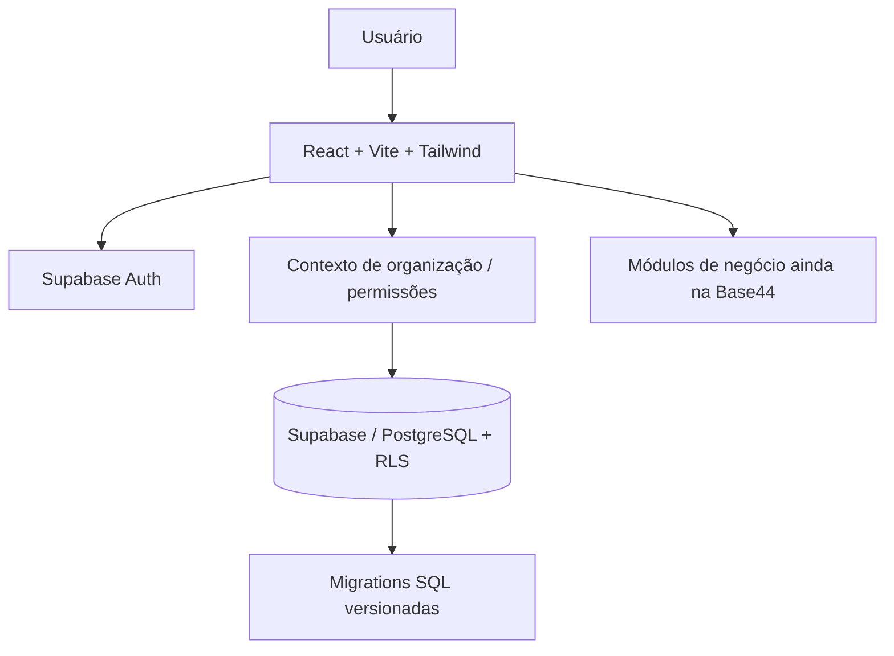

<div align="center">

# 📑 LICITS

### Gestão de contratos, fiscalização e registros de preços

**Aplicação web corporativa construída com React, Vite e Tailwind CSS.**  
Organização de contratos, documentos, ocorrências, registros de preços e rotinas de fiscalização.

[](https://github.com/WalterMatheusgg/Licits/actions/workflows/ci.yml)


[**Funcionalidades**](#-módulos-e-recursos) · [**Tecnologias**](#-tecnologias) · [**Executar**](#-executar-localmente) · [**Arquitetura**](#-arquitetura) · [**Documentação**](#-documentação) · [**Próximos passos**](#-próximos-passos)

</div>

---

## 🎯 Sobre o projeto

O **Licits** é uma aplicação de gestão contratual com uma interface orientada às rotinas administrativas de acompanhamento de contratos, fiscalização, documentos, ocorrências e atas de registro de preços.

O frontend utiliza **React 18**, **Vite 6**, **Tailwind CSS**, componentes **Radix UI**, **TanStack Query**, formulários e gráficos. O código está organizado por páginas, componentes reutilizáveis, serviços e contextos de autenticação e organização.

> [!IMPORTANT]
> **Projeto em evolução — não homologado para produção.** O Licits está em processo de migração da **Base44 para Supabase**. A fundação de autenticação e contexto multi-organização foi implementada, porém vários módulos de negócio ainda chamam a API Base44. **Não considere todos os fluxos operacionais migrados ou validados.** Consulte o [progresso da migração](docs/MIGRATION_PROGRESS.md).

## 🧩 Módulos e recursos

Os módulos abaixo representam **telas e fluxos presentes no código-fonte**; sua integração pode depender da Base44 enquanto a migração está incompleta.

| Área | O que existe no projeto |
|:--|:--|
| 📊 **Dashboard** | Indicadores, gráficos de contratos, consumo e acompanhamento |
| 📑 **Contratos** | Listagem, filtros, formulários, detalhes e análises |
| 🗂️ **Documentos** | Interfaces para arquivos e documentos contratuais |
| 🛡️ **Fiscalização** | Acompanhamento fiscal e registros de ocorrências |
| 🧾 **Registros de preços** | Telas de atas, grupos, itens e acompanhamento |
| 👥 **Administração** | Interfaces de usuários, permissões e solicitações administrativas |
| 🔔 **Notificações** | Indicadores no TopBar e páginas de acompanhamento |
| 🤖 **Assistente de IA** | Interfaces em desenvolvimento; integração de processamento ainda pendente |
| 🔐 **Identidade e organização** | Login e recuperação de senha pelo Supabase Auth; organização ativa e controle de acesso no frontend |

### Estado das integrações

| Frente | Estado documentado |
|:--|:--|
| React, rotas, layout e componentes | ✅ Código-fonte disponível |
| Autenticação Supabase e seleção de organização | 🟡 Implementadas; validação remota ainda necessária |
| PostgreSQL, migrations e políticas RLS | 🟡 Definidos no repositório; aplicação e isolamento precisam ser verificados no ambiente-alvo |
| CRUD de contratos, documentos e fiscalizações no Supabase | 🚧 Migração pendente — chamadas Base44 ainda presentes |
| IA para extração/análise contratual | 🚧 Fluxo e integração backend pendentes |
| Envio de e-mails e migração integral de notificações | 🚧 Pendente |
| Build / lint / typecheck | ✅ Pipeline de integração contínua configurada |

## 🧰 Tecnologias

| Camada | Tecnologias |
|:--|:--|
| **Interface** | React 18, JavaScript/JSX, Vite 6, Tailwind CSS |
| **Componentes** | Radix UI, ícones Lucide, Framer Motion |
| **Dados e formulários** | TanStack Query, React Hook Form, Zod |
| **Gráficos** | Recharts |
| **Autenticação e banco em migração** | Supabase Auth, PostgreSQL, Row Level Security, Storage |
| **Legado ainda presente** | SDK e plugin da Base44 |
| **Qualidade** | ESLint, TypeScript (checagem via JSConfig), GitHub Actions |

## 🏗️ Arquitetura



A separação multiempresa é modelada por `organization_id`, membros e papéis, com políticas RLS nas migrations. **O isolamento efetivo deve ser testado** com usuários de organizações distintas antes de disponibilizar dados reais.

## 🚀 Executar localmente

**Pré-requisitos:** Node.js 20 ou superior, npm, projeto Supabase de desenvolvimento e, para fluxos legados ainda não migrados, acesso/configuração correspondente da Base44.

```bash
git clone https://github.com/WalterMatheusgg/Licits.git
cd Licits
npm ci
cp .env.example .env.local
npm run dev
```

No `.env.local`, informe as configurações **públicas** do projeto Supabase:

```dotenv
VITE_SUPABASE_URL=https://seu-projeto.supabase.co
VITE_SUPABASE_PUBLISHABLE_KEY=sua-chave-publica
```

Abra o endereço exibido pelo Vite no terminal (normalmente **http://localhost:5173**).

> [!WARNING]
> O frontend **não deve receber** `SUPABASE_SERVICE_ROLE_KEY`, `SUPABASE_SECRET_KEY`, `OPENAI_API_KEY` ou qualquer chave privada. Variáveis prefixadas por `VITE_` podem ser incluídas no bundle entregue ao navegador. Mantenha credenciais privadas em serviços backend seguros.

**Primeiro acesso:** configure um usuário no Supabase Auth e um vínculo ativo a uma organização. Consulte [Autenticação](docs/AUTHENTICATION.md); não há conta de demonstração pública distribuída no repositório.

### Banco de dados e migrations

As migrations estão em `supabase/migrations/`. Faça a aplicação **primeiro em um projeto de desenvolvimento**, revisando as alterações:

```bash
npx supabase@latest login
npx supabase@latest link --project-ref SEU_PROJECT_REF
npx supabase@latest db push --dry-run --linked
# Depois de revisar e aprovar:
npx supabase@latest db push --linked
```

A documentação da migração registra uma etapa de reforço de segurança ainda sujeita a validação. Não execute migrations às cegas em um banco de produção.

### Verificações disponíveis

```bash
npm run typecheck
npm run lint
npm run build
```

A [CI do GitHub](.github/workflows/ci.yml) executa `npm ci`, checagem de tipos, lint e build. **Build aprovado não equivale à validação dos fluxos integrados com banco e autenticação reais.**

## 📁 Estrutura do repositório

```text
Licits/
├── src/
│   ├── pages/              # Dashboard, contratos, fiscalização, administração
│   ├── components/         # UI, formulários e componentes de negócio
│   ├── contexts/           # Organização ativa
│   ├── lib/                # Auth, queries e utilitários
│   └── api/                # Cliente Base44 ainda necessário
├── bd/entities/            # Modelos históricos do domínio
├── supabase/
│   ├── migrations/         # Schema, funções e regras de segurança
│   └── tests/              # Scripts SQL de verificação
├── docs/                   # Arquitetura, segurança e migração
├── .github/workflows/      # Validação automatizada
├── .env.example            # Configuração pública de exemplo
└── package.json
```

## 📚 Documentação

- [Autenticação e primeiro usuário](docs/AUTHENTICATION.md)
- [Modelo de dados e migrations](docs/DATABASE.md)
- [Controles e testes de segurança](docs/SECURITY.md)
- [Progresso da migração](docs/MIGRATION_PROGRESS.md)
- [Auditoria técnica da migração](docs/MIGRATION_AUDIT.md)
- [Validação da fase de autenticação](docs/PHASE4_VALIDATION.md)
- [README original preservado do ZIP](docs/README-ORIGINAL-DO-ZIP.md)

## 🗺️ Próximos passos

- [ ] Migrar contratos, fornecedores e itens da Base44 para Supabase.
- [ ] Migrar documentos, fiscalizações, ocorrências e registros de preços.
- [ ] Concluir notificações e fluxos de administração.
- [ ] Implementar processamento seguro de documentos e IA no backend.
- [ ] Executar testes de integração e isolamento entre organizações.
- [ ] Eliminar dependências Base44 após validar a migração.
- [ ] Publicar capturas de tela reais e uma demonstração após configurar o ambiente.

---

<div align="center">

**LICITS** · Gestão contratual · React / Supabase · Projeto em desenvolvimento

Mantido por **[Walter Matheus](https://github.com/WalterMatheusgg)**  
[GitHub](https://github.com/WalterMatheusgg) · [NEXUS CRM](https://github.com/WalterMatheusgg/NEXUS)

</div>
