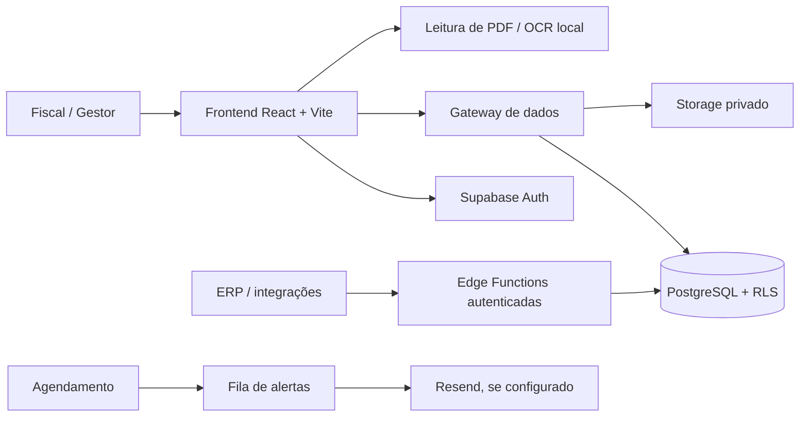

<div align="center">

# 📑 LICITS
### Plataforma de Gestão e Fiscalização de Contratos

**Controle contratual, saldo orçamentário, compras, prazos, evidências e alertas em um só lugar.**

[](https://github.com/WalterMatheusgg/Licits/actions/workflows/ci.yml)
[](https://github.com/WalterMatheusgg/Licits/actions/workflows/supabase-db-ci.yml)
[](https://github.com/WalterMatheusgg/Licits/actions/workflows/edge-functions-ci.yml)

**React 18 • Vite 6 • Tailwind CSS • Supabase Auth • PostgreSQL • Edge Functions**

**Estado: desenvolvimento e homologação.** Código versionado e testes automatizados não significam que o banco remoto, e-mails, IA e restauração de backups já foram homologados.

</div>

---

## O que o Licits resolve

O Licits foi concebido para que **cada fiscal de contratos saiba exatamente o que precisa acompanhar**, quanto já foi utilizado e o que requer atenção.

| Necessidade do fiscal | Recurso desenvolvido |
| :--- | :--- |
| Conhecer os contratos sob sua responsabilidade | Carteira do fiscal e dashboard de acompanhamento |
| Evitar gastos acima do contrato | Simulação da compra e baixa transacional no PostgreSQL |
| Antecipar o esgotamento de saldo | Alertas ao cruzar 80%, 90% e 100% do valor autorizado |
| Acompanhar vencimentos | Indicadores, tarefas e fila de avisos de vigência |
| Organizar execução e evidências | Documentos privados, fiscalizações e ocorrências |
| Manter rastreabilidade | Auditoria, permissões por organização e controle de acesso |
| Integrar outros sistemas | API de contratos via Edge Function com credenciais limitadas |

**Importante:** saldo de itens contratados não é o mesmo que estoque físico do almoxarifado; as movimentações atualmente registram utilização do contrato.

### Exemplo de teste: 50% consumido

Um contrato demonstrativo de **R$ 100.000,00** começa com **R$ 50.000,00 utilizados**. O fiscal simula aquisições e vê o impacto antes de registrar; a operação é bloqueada se exceder a quantidade ou o valor global permitido.

- [Cenário de contrato fictício com 50% de uso](docs/CONTRATO-DEMONSTRACAO.md)
- [Configuração da fila de alertas e envio por e-mail](docs/ALERTAS-FISCAL.md)

## Funcionalidades

| Módulo | Recursos no código-fonte |
| :--- | :--- |
| **Autenticação** | Supabase Auth, sessão persistente, recuperação de senha e convites |
| **Organizações e permissões** | Membros e políticas RLS no banco |
| **Contratos** | Fornecedores, valores, itens, movimentações, edição e arquivamento |
| **Fiscalização** | Carteira, tarefas, prazos, ocorrências e registros |
| **Compras e saldos** | Prévia por quantidade/preço; bloqueio de excesso em operação transacional |
| **Atas de registro de preços** | Grupos, itens e acompanhamentos vinculados |
| **Documentos** | Upload privado, leitura de PDF, OCR local e revisão dos dados |
| **Notificações** | Alertas de teto, vencimento e leitura individual |
| **Administração** | Convites, perfis, solicitações e trilha de auditoria |
| **API de integração** | Consultas e operações de contratos autenticadas em Edge Functions |

O assistente local responde a perguntas estruturadas com os dados que o usuário pode consultar. **Ele não é um modelo generativo treinado localmente.** Recursos opcionais de IA por serviços externos dependem de configuração e teste próprios.

## Como executar

**Pré-requisitos:** Node.js 22, npm e um projeto Supabase de desenvolvimento/homologação com acesso autorizado.

```bash
git clone https://github.com/WalterMatheusgg/Licits.git
cd Licits
npm ci
cp .env.example .env.local
```

Configure `.env.local` usando **somente** os valores públicos fornecidos pelo seu projeto Supabase:

```dotenv
VITE_SUPABASE_URL=https://SEU-PROJETO.supabase.co
VITE_SUPABASE_PUBLISHABLE_KEY=SUA_CHAVE_PUBLICA
VITE_ENVIRONMENT=development
```

```bash
npm run dev
```

Abra o endereço mostrado pelo Vite (geralmente **http://localhost:5173**). Em Codespaces, abra a porta **5173** no painel **Ports**.

> **Segurança:** nunca versione senhas, URLs privadas de conexão do PostgreSQL, chaves `service_role`, `RESEND_API_KEY`, `OPENAI_API_KEY` ou tokens administrativos. O repositório privado não substitui o gerenciamento de segredos. Arquivos `.env` e `.env.local` estão no `.gitignore`.

### Supabase

Aplique migrations **somente em homologação após verificar o destino e ter backup recuperável**:

```bash
npx supabase login
npx supabase link --project-ref SEU_PROJECT_REF
npx supabase migration list
npx supabase db push --dry-run
# Após revisar cuidadosamente o resultado:
npx supabase db push
```

O acesso ao Licits exige usuário em **Supabase Authentication**, perfil ativo e vínculo ativo com uma organização.

- [Autenticação, organização e primeiro administrador](docs/AUTHENTICATION.md)
- [Recuperar login e conexão existentes](docs/RECUPERAR-ACESSO.md)

### Integrações e alertas por e-mail

As funções ficam em `supabase/functions/`. Após configurar os segredos do servidor, implante as funções necessárias com o Supabase CLI. A entrega de alertas depende adicionalmente do **Resend**, de um remetente verificado e do agendamento. Os avisos gerados no banco **não comprovam entrega por e-mail**.

- [Guia de acesso e integrações](docs/GUIA-ACESSO-INTEGRACOES.md)
- [Manual de alertas fiscais](docs/ALERTAS-FISCAL.md)
- [API de integração v1](docs/API-INTEGRACAO-V1.md)
- [Especificação OpenAPI](docs/openapi-integration-v1.json)

## Arquitetura



A autorização de cada operação é aplicada no PostgreSQL por políticas RLS e funções específicas; esconder botões na interface **não substitui autorização no servidor**.

## Testes

```bash
npm ci
npm run lint
npm run typecheck
npm run build
node --test tests/*.test.js
```

Há três pipelines no GitHub Actions: **Frontend**, **Supabase SQL** e **Edge Functions**. Os badges acima mostram o estado mais recente de cada pipeline; confira as execuções para localizar falhas ou testes pendentes.

Os testes de banco sobem um ambiente **local descartável** e verificam migrations, isolamento entre organizações e operações contratuais. Eles **não substituem** testes ponta a ponta no navegador com o banco remoto, envio real de e-mails ou restauração integral de PostgreSQL e Storage.

## Segurança e próximos passos

| Item | Situação verificada no repositório |
| :--- | :--- |
| 1. Remover dependência direta do SDK Base44 no frontend | **Implementado** |
| 2. Gateway Supabase com escopo por organização | **Implementado**; homologar no projeto remoto |
| 3. RPC transacional para baixa de itens | **Implementado**, com testes SQL locais |
| 4. Edge Functions para segredos e integrações | **Código implementado** |
| 5. CI de typecheck, lint e build | **Configurada** |
| 6. Migrations aplicadas e validadas no Supabase remoto | **Pendente de comprovação no projeto de destino** |
| 7. Autenticação, perfis e isolamento entre organizações | **Testes SQL locais**; faltam contas reais de homologação |
| 8. CRUD de contratos, documentos, fiscalização, atas e convites | **Testes de banco existentes**; faltam testes completos da interface |
| 9. Implantação e e-mails/IA reais | **Pendente de implantação e teste com chaves do servidor** |
| 10. Retenção, backup, monitoramento e produção | **Guias e script de backup presentes**; rotinas reais e restore pendentes |

**Pronto para produção? Ainda não.** É necessário homologar a autenticação e os fluxos reais, comprovar as integrações externas, configurar monitoração, backups recorrentes de banco **e arquivos** e realizar teste documentado de restauração.

- [Segurança e políticas](docs/SECURITY.md)
- [Procedimentos de backup e recuperação](docs/PRODUCAO-RECUPERACAO.md)
- [Plano de homologação](docs/PLANO-PRODUCAO-LICITS.md)

## Organização do repositório

```text
Licits/
├── src/                      # Páginas, componentes, hooks e gateway Supabase
├── supabase/
│   ├── migrations/           # Esquema, políticas RLS, triggers e funções SQL
│   ├── functions/            # Funções de servidor e integração
│   ├── tests/                # Testes SQL
│   └── demo/                 # Dados inteiramente fictícios de demonstração
├── tests/                    # Testes unitários locais
├── docs/                     # Manuais e checklists
├── scripts/                  # Apoio de operação e backup
└── .github/workflows/        # Testes e agendamentos
```

---

<div align="center">

**LICITS — Gestão de contratos com foco no trabalho do fiscal.**

Desenvolvido e mantido por [Walter Matheus](https://github.com/WalterMatheusgg).

</div>
